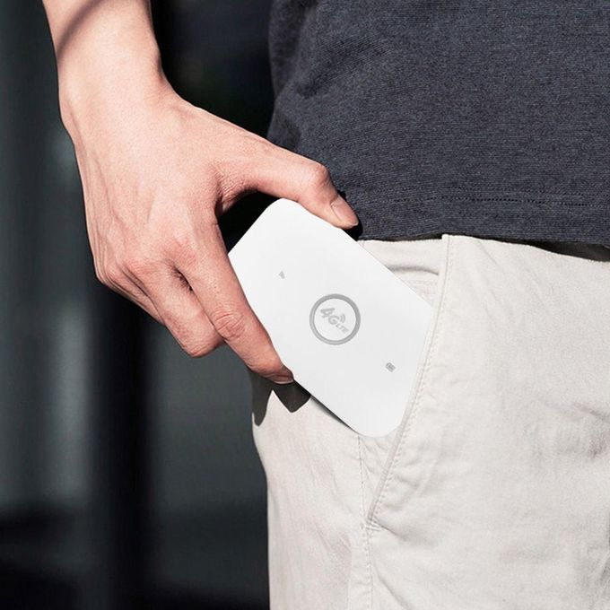
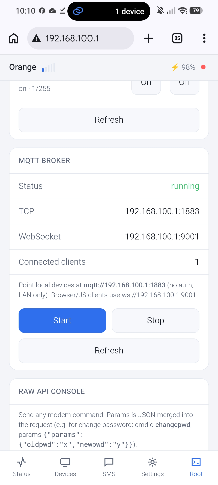
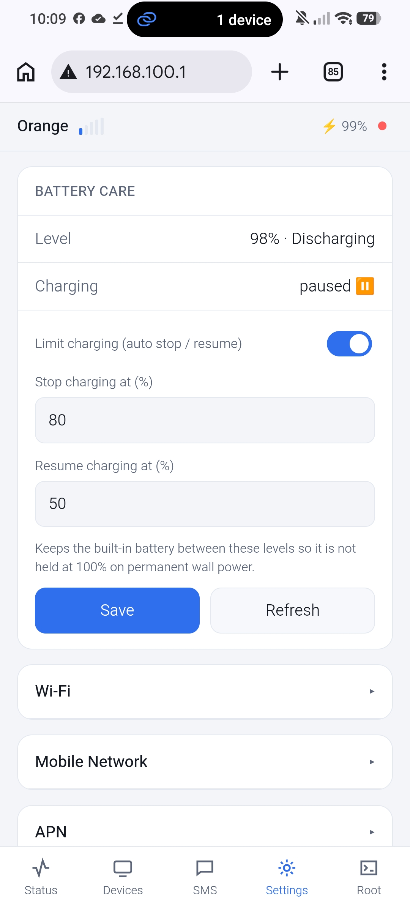
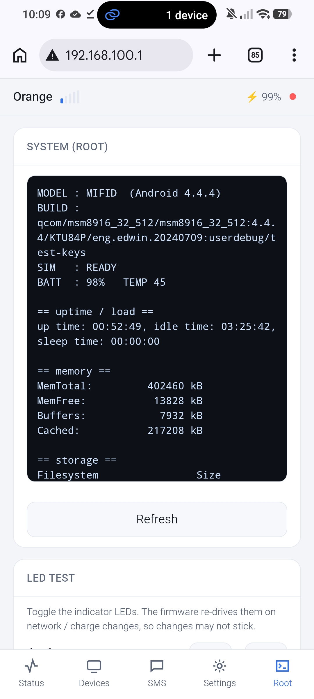
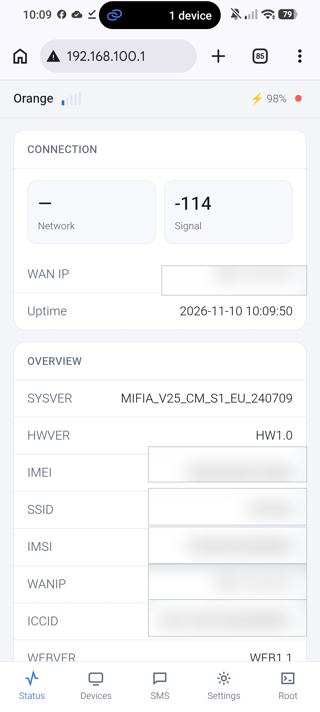

# Pocket MQTT Broker — an old 4G MiFi router turned into a tiny always-on broker

<p align="center">
  
</p>

> **🤖 AI agents (Claude Code, Codex, Cursor, …):** if a user gave you this repo to set up, don't
> start from this README. Read **[docs/HOWTO.md → Instructions for AI agents](docs/HOWTO.md#instructions-for-ai-agents)**
> first and follow the steps it points to. It has the device check, the safety rules (backup first,
> test-boot before flashing, ask the user before every flash write) and the tested commands.
>
> **👤 Humans:** [step-by-step manual setup](docs/HOWTO.md#manual-setup-step-by-step) (copy and
> paste) · [let an AI agent do it](docs/HOWTO.md#with-claude-code-or-another-ai-agent) (one prompt)

I had an old 4G MiFi hotspot in a drawer — the little kind with a built-in battery and its own
Wi-Fi — and turned it into a self-contained **MQTT broker** for my home devices. No Raspberry Pi,
no PC left running: it already has Wi-Fi, a battery so it rides through power blips, and it barely
sips power.

Most of this was built with **[Claude Code](https://claude.com/claude-code)** — I talked it through
what I wanted and it did the heavy lifting: rooting the router, figuring out what would actually run
on it, writing the web UI, and getting the broker going.

While it was in there it also:

- gave it a clean little web page to manage it (the stock one was awful), and
- added a battery **"don't cook yourself"** feature — since it's always plugged into the wall, it
  stops charging at 80% and tops back up at 60% so the battery doesn't wear out sitting at full.

> **Heads up:** this is a personal hack for one specific router (a Qualcomm MSM8916 / Android 4.4
> MiFi). It is **not** a plug-and-play package for any device — it needs root and pokes at low-level
> stuff. Posting it because people asked how it works. No warranty; you're on your own if you brick
> something.

## Screenshots

Real screenshots from the UI running on the router (device IDs blurred on the status page):

| MQTT broker | Battery care | System (root) | Status |
|---|---|---|---|
|  |  |  |  |

## What it does

- **MQTT broker** on the router — plain MQTT on `:1883` and WebSocket on `:9001`, open to the local
  network so devices connect straight to `mqtt://<router-ip>:1883`. Auto-starts on boot.
- **A clean web UI** to manage the router (the stock one was rough): live status, connected devices,
  Wi-Fi / mobile-network / APN / DHCP settings you can actually edit and save, change the web
  password, SMS viewer, and a few root tools.
- **Battery "don't cook yourself" mode** — keeps the always-plugged battery bouncing between 60% and
  80% instead of sitting at 100%.
- **Traffic/notification LED** — the router's charge LED (red + green) doubles as an activity light:
  it **flashes red whenever a message passes through the broker** (either direction), glows **green**
  while a client is connected, and can be overridden by publishing to the topic `led`
  (`green` / `red` / `off` / `auto`). A web toggle switches the LED between this and its normal
  battery-charge indication. (No yellow — it never lights both at once.)
- **MQTT + LED + system panels** under a Root tab, all gated behind the router's own login.

## Connecting a device

Join the router's Wi-Fi, then point your MQTT client at:

```
mqtt://<router-ip>:1883        # normal clients
ws://<router-ip>:9001          # browser / JavaScript clients
```

No username/password (it's local-network only). Quick test:

```
mosquitto_sub -h <router-ip> -t '#' -v
mosquitto_pub -h <router-ip> -t test -m hello
```

## Set it up yourself

Two ways, both in **[docs/HOWTO.md](docs/HOWTO.md)**:

- **[Manual, step by step](docs/HOWTO.md#manual-setup-step-by-step)**: tools to install, a full
  backup, rooting, building the broker, installing. Each step is commands you can copy and paste,
  with the output you should see.
- **[With Claude Code or another AI agent](docs/HOWTO.md#with-claude-code-or-another-ai-agent)**:
  paste one prompt. The agent runs the same steps and asks you before anything risky or physical.

The same file explains [how it works](docs/HOWTO.md#how-it-works): why Go instead of mosquitto,
the notification LED, and the battery charge limiter.

## Credits

Built by me + **[Claude Code](https://claude.com/claude-code)**. The MQTT broker is
[mochi-mqtt/server](https://github.com/mochi-mqtt/server). Served with BusyBox.

## License

MIT — see [LICENSE](LICENSE).
