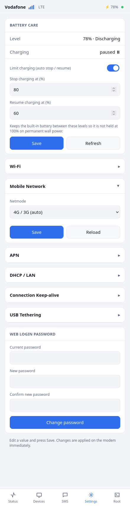
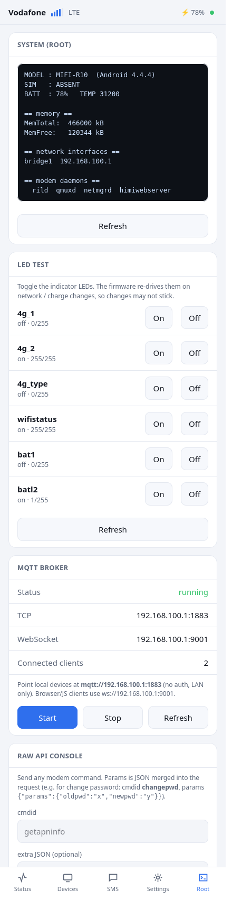

# Pocket MQTT Broker — an old 4G MiFi router turned into a tiny always-on broker

I had an old 4G MiFi hotspot in a drawer — the little kind with a built-in battery and its
own Wi-Fi — and turned it into a self-contained **MQTT broker** for my home devices. No
Raspberry Pi, no PC left running: it already has Wi-Fi, a battery so it rides through power
blips, and it barely sips power.

Most of this was built with **[Claude Code](https://claude.com/claude-code)** — I talked it
through what I wanted and it did the heavy lifting: rooting the router, figuring out what
would actually run on it, writing the web UI, and getting the broker going.

> **Heads up:** this is a personal hack for one specific router (a Qualcomm MSM8916 /
> Android 4.4 MiFi). It is **not** a plug-and-play package for any device. It needs root and
> it pokes at low-level stuff. Posting it because people asked how it works — treat it as a
> reference, not a flashing guide. No warranty, you're on your own if you brick something.

## Screenshots

| Status | Settings | Root tools |
|---|---|---|
|  |  |  |

_(screenshots taken from the UI running on the router — add your own in `docs/screenshots/`)_

## What it does

- **MQTT broker** on the router — plain MQTT on `:1883` and WebSocket on `:9001`, open to the
  local network so devices connect straight to `mqtt://<router-ip>:1883`. Auto-starts on boot.
- **A clean little web UI** to manage the router (the stock one was rough): live status, connected
  devices, Wi-Fi / mobile-network / APN / DHCP settings you can actually edit and save, change the
  web password, SMS viewer, and a few root tools.
- **Battery "don't cook yourself" mode** — since the router is always on wall power, a small daemon
  stops charging at 80% and resumes at 60% so the built-in battery doesn't sit at 100% and wear out.
- **MQTT + LED + system panels** under a Root tab, all gated behind the router's own login.

## Why Go for the broker (and not mosquitto)

The obvious choice was mosquitto, but the ready-made mosquitto builds won't run on this router —
it's an Android device and its system libraries don't match the ones those builds expect. Building
mosquitto to fit would've meant setting up a whole cross-compiler and rebuilding its dependencies.

Go sidesteps all of that: it cross-compiles to a **single self-contained binary** that runs on the
router as-is. The broker itself is [mochi-mqtt](https://github.com/mochi-mqtt/server), wrapped in a
tiny `main.go`. That's the whole reason — not a preference, just the path that actually worked.

## How it's put together

Everything lives in `/data/local/tmp/webui/` on the router (survives reboots; the stock system
partition is left alone):

- A small static **BusyBox `httpd`** serves the web UI and proxies API calls to the router's existing
  service, so the new UI is same-origin with no CORS fuss and the stock backend stays untouched.
- The UI's root-powered endpoints (CGI scripts) each **validate the router's login session** before
  doing anything, so they aren't open to the network.
- Port 80 is pointed at the new UI via a firewall rule; the stock UI stays reachable on its own port.
- A boot hook (an init service added to a rooted boot image) starts the web server, the broker, and
  the battery daemon on every boot.

```
webui/
  www/index.html            # the whole UI, one vanilla-JS file (no framework)
  www/cgi-bin/              # api (proxy), sms, bat, battctl, led, mqtt, sysinfo
  boot.sh                   # runs at boot: start httpd + broker + battery daemon, fix firewall
  battd.sh / battd.conf     # battery charge limiter
  start.sh / httpd.conf     # manual start + httpd config
broker/
  main.go / go.mod / go.sum # the MQTT broker (mochi-mqtt), build with:
                            #   GOOS=linux GOARCH=arm GOARM=7 CGO_ENABLED=0 go build -o mqttbroker .
```

## Connecting a device

Join the router's Wi-Fi, then point your MQTT client at:

```
mqtt://<router-ip>:1883        # normal clients
ws://<router-ip>:9001          # browser / JavaScript clients
```

No username/password (it's local-network only). Quick test:

```
mosquitto_sub -h <router-ip> -t '#' -v
mosquitto_pub -h <router-ip> -t test -m hello
```

## Credits

Built by me + **[Claude Code](https://claude.com/claude-code)**. The MQTT broker is
[mochi-mqtt/server](https://github.com/mochi-mqtt/server). Served with BusyBox.

## License

MIT — see [LICENSE](LICENSE).
